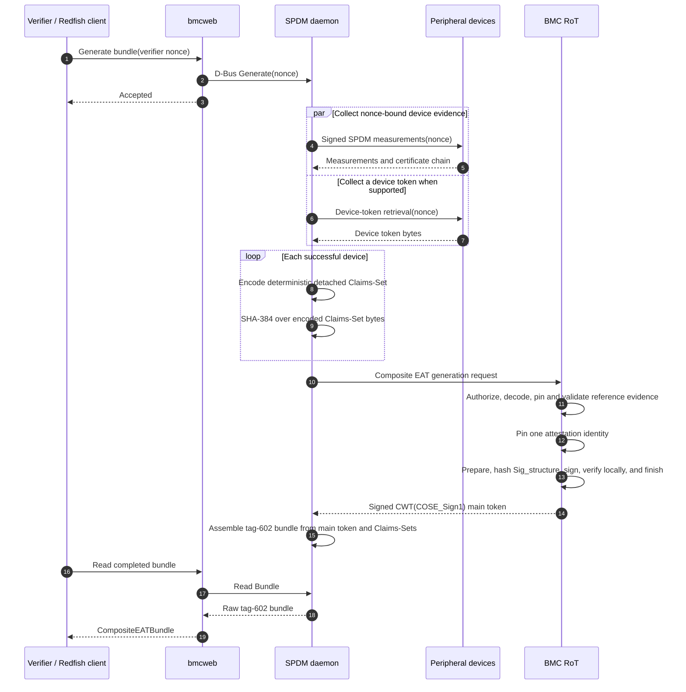
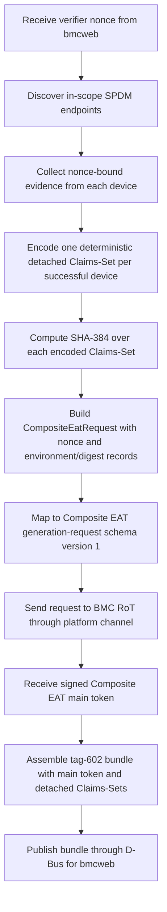
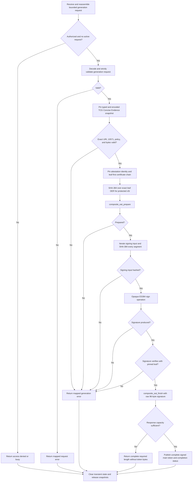

# BMC Composite EAT Integration Guide

## End-To-End Flow

The BMC SPDM daemon and the Root of Trust produce different artifacts:

- spdmd collects device evidence, builds deterministic detached Claims-Sets,
  computes their SHA-384 digests, and assembles the final tag-602 Detached EAT
  Bundle;
- the RoT acts as the Lead Attester and returns only the signed Composite EAT
  main token that commits to those digests.

The published
[Composite EAT Internet-Draft -00](https://datatracker.ietf.org/doc/html/draft-sun-rats-composite-eat-00)
is the draft reference for main-token claims, CWT/COSE structure, Detached EAT
Bundle semantics, and verification guidance. It is work in progress, not an RFC
or IETF endorsement; see the
[Datatracker document page](https://datatracker.ietf.org/doc/draft-sun-rats-composite-eat/)
for current status. This guide defines how spdmd, platform transport, and RoT
firmware divide the implementation work.



This sequence is adapted from the BMC-mediated platform composite-attestation
design. Composite EAT generation-request schema version 1 carries only the
nonce and device digest records. It does not carry the design's optional
Platform CoRIM locator. See the
[BMC-to-RoT generation contract](bmc-to-rot-composite-eat-generation-contract.md)
for the complete request, response, and transport-status boundary.
`RotPlatformAttester` and `CompositeEatTransport` are
logical BMC-side implementation components, not separate end-to-end actors.
`RotPlatformAttester` runs in spdmd; the transport implementation may remain in
userspace or call through a Linux kernel driver.

## BMC spdmd Side Flow

spdmd owns device-evidence collection and the final Detached EAT Bundle. Its
interaction with the RoT is deliberately digest-only.



[NVIDIA/spdm PR #2](https://github.com/NVIDIA/spdm/pull/2) at commit `5627b88`
provides the collection plan, evidence builders, deterministic CBOR support,
detached submodule digests, bundle assembler, composite orchestrator, D-Bus
producer, `PlatformAttester` contract, and a software-only mock backend. It is
an open upstream reference as of 2026-08-27, not released NVIDIA spdmd
functionality.

The SDK's `examples/spdmd/` directory adds reference follow-up code:

- `RotPlatformAttester` implements the PR's `PlatformAttester` interface;
- it rejects fields unsupported by generation-request schema version 1, maps
   the nonce and device records, and calls
   `composite_eat_generation_request_encode`;
- it submits only bounded encoded bytes through `CompositeEatTransport`;
- it returns the RoT's signed main token unchanged to the orchestrator.

The platform implements `CompositeEatTransport::isReady` and
`CompositeEatTransport::submit`. This BMC-side integration may live in spdmd,
a supporting userspace library, or a Linux kernel driver plus userspace
wrapper. It owns RoT endpoint availability, command identifiers, framing,
fragmentation, request correlation, response capacity, timeouts, retries, late
completion, and reset recovery. It must not parse, construct, or rewrite
Composite EAT claims.

See [the spdmd integration guide](spdmd-composite-eat-integration.md) for the
code-level adapter contract.

## BMC RoT Composite EAT Flow

The RoT command handler is platform code around the SDK. It owns authorization,
trusted evidence and identity access, cryptography, and atomic response
publication.



The flow has four trust-sensitive stages:

1. **Ingress and authorization.** Snapshot untrusted shared memory before the
   producer can modify it, authenticate and rate-limit the command, and reject
   overlap or serialize it explicitly. Do not access evidence or keys before
   `composite_eat_generation_request_decode` succeeds.
2. **Coherent snapshots.** Pin one UEID, the exact published `-00` profile URI,
  typed and encoded TCG Concise Evidence under Content-Format 10571, a
  non-exportable ES384 identity, and canonical leaf-first DER certificate
  chain for the complete operation. Validate the typed evidence against
  platform policy and require byte identity with the buffered claim-273
  snapshot. BMC-supplied bytes are not trusted local evidence.
3. **Prepare and sign.** Bind the leaf certificate with SHA-384, call
  `composite_eat_prepare`, stream the signing input through
  `composite_eat_write_signing_input`, and sign that digest through the pinned
  opaque key operation. Verify the returned fixed-width signature against the
  pinned leaf before finishing. Private-key bytes never enter the SDK.
4. **Finish and publish.** Call `composite_eat_finish`; report the complete
   required length instead of truncating. Make all response bytes visible
   before publishing success, then call `composite_eat_clear`, abort any active
   hash operation, release snapshots, and clear transient state on every exit.

The complete C lifecycle is shown in `examples/rot/software_platform.c`.
See [RoT evidence and claim ownership](rot-evidence-and-claim-ownership.md) for
evidence ownership and provider semantics, and
[RoT attestation identity and COSE headers](rot-attestation-identity-and-cose-headers.md)
for the key, leaf certificate, `x5t`, and `x5chain` invariants.

## Modules And Implementation Status

After the two runtime flows, the implementation boundary is:

| Module or function | Runtime owner | Status and source |
|---|---|---|
| SPDM endpoint collection and nonce propagation | spdmd | Available in [NVIDIA/spdm PR #2](https://github.com/NVIDIA/spdm/pull/2) at `5627b88` |
| Detached Claims-Set construction and SHA-384 digesting | spdmd | Available in [NVIDIA/spdm PR #2](https://github.com/NVIDIA/spdm/pull/2) at `5627b88` |
| Composite orchestration, tag-602 assembly, and D-Bus producer | spdmd | Available in [NVIDIA/spdm PR #2](https://github.com/NVIDIA/spdm/pull/2) at `5627b88` |
| Vendor-neutral `PlatformAttester` and software mock | spdmd | Available in [NVIDIA/spdm PR #2](https://github.com/NVIDIA/spdm/pull/2) at `5627b88`; mock is test only |
| Generic `RotPlatformAttester` and generation-request mapping | BMC userspace | Reference implementation in `examples/spdmd/` |
| BMC-to-RoT transfer, timeout, retry, and reset | BMC userspace or Linux kernel | Platform implementation required behind `CompositeEatTransport` |
| Generation-request codec | RoT firmware, optionally BMC adapter | Implemented by `bmc::generation_request` |
| Composite EAT token builder | RoT firmware | Implemented by `bmc::composite_eat` |
| TCG DICE Concise Evidence helper | Platform evidence adapter | Optional `bmc::tcg_concise_evidence` target |
| Published `-00` URI plus 10571 reference policy | RoT firmware | `composite_eat_reference_policy_validate_snapshot` |
| Command authorization, serialization, and atomic response publication | RoT firmware | Platform implementation required |
| UEID, profile, local evidence, certificate chain, SHA-384, and ES384 | RoT firmware | Platform implementation required; provider examples are under `examples/rot/` |
| Redfish-to-D-Bus integration | BMC web service | Platform integration required |
| Evidence appraisal and completeness decision | Verifier | Outside this SDK |

PR #2 remains open as of 2026-08-27 and must not be described as released
NVIDIA spdmd functionality until it is merged.

### SDK Package Structure

```text
include/composite_eat/
  generation_request.h       Public typed generation request and CBOR codec API
  token_builder.h            Split-phase signed main-token API
  tcg_concise_evidence.h     Optional bounded TCG evidence serializer
  profile_evidence.h         Caller-supplied evidence policy validation
  reference_policy.h         Closed published-IETF-00/TCG-CE reference policy
  types.h                    Bounded request, evidence, identity, and workspace types
  status.h                   SDK status values
  version.h                  Draft API version
src/
  generation_request.c       Strict generation-request encoder and decoder
  token_builder.c            Claims, COSE/CWT, signing input, and final assembly
  tcg_concise_evidence.c     TCG structural validation and deterministic encoding
  profile_evidence.c         Profile limits and policy validation
  reference_policy.c         Exact URI, 10571, and encoded-byte validation
  types.c                    Shared validation
examples/
  spdmd/
    rot_platform_attester.*  Generic PlatformAttester adapter
    composite_eat_transport.hpp
                             Platform-owned BMC transfer boundary
    platform_transport_skeleton.cpp
                             BMC transport implementation starting point
  rot/
    software_platform.h      Documented synchronous orchestration API
    software_platform.c      Complete RoT generation lifecycle
    platform_evidence.h      Evidence snapshot provider shape
    evidence_provider_skeleton.c
    platform_attestation.h   Identity, SHA-384, and opaque ES384 provider shape
    attestation_provider_skeleton.c
docs/
  bmc-composite-eat-integration-guide.md
  bmc-to-rot-composite-eat-generation-contract.md
  spdmd-composite-eat-integration.md
  tcg-concise-evidence-helper.md
  release-notes-0.8.md
tests/
  generation_request_test.c  Strict codec and boundary tests
  token_builder_test.c       Builder state, bounds, and determinism tests
  tcg_concise_evidence_test.c
                             TCG evidence structure, policy, and vectors
  reference_policy_test.c    Exact URI, 10571, schema, policy, and byte checks
  rot_platform_example_test.c
                             Provider ordering, release, and cleanup test
  spdmd_adapter_test.cpp     Mapping, transport delegation, and pass-through test
  generate_test_token.c      Synthetic signed-token generator
  verify_negative_test.py    Tamper and certificate negative cases
  vectors/                   Fixed synthetic interoperability artifacts
tools/
  verify.py                  Independent token and certificate-chain verifier
  validate_tcg_cddl.sh       Optional offline complete-schema validation
third_party/qcbor/           Pinned QCBOR 1.6.2 subset
```

### SDK Boundary

The SDK includes:

- strict private Composite EAT generation-request encoding and decoding;
- typed request, evidence, identity, workspace, and prepared-state structures;
- deterministic CWT and COSE_Sign1 construction;
- protected ES384 algorithm, content type, and leaf-certificate thumbprint;
- unprotected leaf-first certificate-chain encoding;
- streamed Sig_structure and final output with required-length behavior;
- optional bounded TCG DICE Concise Evidence serialization and policy checks;
- exact published-IETF-00 URI and 10571 reference-deployment validation;
- RoT C provider examples and the spdmd C++ adapter example;
- synthetic vectors, unit tests, and an independent verifier.

The SDK deliberately does not include:

- a hardware command number or universal transport;
- command authorization, scheduling, locking, or interrupt handling;
- measurement collection or a platform-specific local-evidence schema;
- key storage, certificate provisioning, SHA-384, or ES384 implementations;
- Detached Claims-Set construction, tag-602 bundle assembly, Redfish, or
  appraisal policy.

## Platform Integration Requirements

- Use one exact 32-byte verifier nonce for every nonce-capable device and the
  Composite EAT generation request.
- Submit at least one detached-device record; this profile does not produce an
  empty Detached EAT Bundle.
- Hash deterministic encoded Claims-Set bytes directly, not a byte-string
  wrapper, base64, or textual representation.
- Treat all BMC request and RoT response bytes as untrusted at their receiving
  boundary.
- Keep evidence, key identity, certificates, leaf thumbprint, and signature
  coherent for one complete operation.
- Never expose the RoT attestation private key or import it into the SDK.
- Preserve one in-flight operation unless the platform explicitly provides
  independent state for concurrency.
- Return the signed main token unchanged; spdmd alone assembles the tag-602
  bundle.
- Define transport integrity, replay, timeout, reset, and late-response
  behavior for the deployed channel.

Environment identifiers are stable expected-location labels such as
`env.nic.0`, not transient bus addresses. The signed token protects the
included label/digest set, but does not prove that spdmd included every expected
device. The verifier detects omission or substitution using independently
trusted platform composition policy and the native device evidence.

## Enable The Platform Implementation

Complete these steps in order and keep the feature disabled by default until
the platform-specific path passes end-to-end validation.

### 1. Select The BMC-To-RoT Channel

Define the platform command, maximum request and response sizes, framing or
fragmentation, request correlation, timeout, reset, late-response handling, and
status mapping. Confirm that the deployed channel can carry
`COMPOSITE_EAT_MAX_GENERATION_REQUEST_LENGTH` request bytes and
`COMPOSITE_EAT_MAX_RESPONSE_LENGTH` response bytes, or reject the configuration
before starting an operation.

### 2. Enable The spdmd Side

1. Build or port `examples/spdmd/rot_platform_attester.*` against the target
  spdmd `PlatformAttester` contract.
2. Implement `CompositeEatTransport` using the selected userspace API or Linux
  driver. Keep hardware framing and recovery out of `RotPlatformAttester`.
3. Add the adapter and transport to the platform's spdmd build option and
  backend factory behind an explicit opt-in gate.
4. Test request mapping, unavailable transport, platform status errors,
  timeout, late completion, oversized responses, and exact main-token
  pass-through.

### 3. Enable The RoT Side

1. Add a bounded command wrapper and connect it to the selected platform
  channel.
2. Link `bmc::generation_request` for CBOR decoding, `bmc::composite_eat` for
  token construction, and `bmc::tcg_concise_evidence` for the reference
  evidence policy and TCG Concise Evidence encoding.
3. Implement coherent typed TCG Concise Evidence, encoded-evidence, and
  attestation-identity snapshots using the contracts under `examples/rot/`.
  Supply platform policy callbacks that authorize each concrete environment
  and measurement set before signing.
4. Connect incremental SHA-384, opaque ES384 signing, and local verification.
5. Drive the split-phase builder as shown in `examples/rot/software_platform.c`
  and map SDK failures to the platform status contract.
6. Gate the command handler, static workspace, evidence access, and signing
  path behind the platform's explicit opt-in feature.

### 4. Validate Before Deployment

1. Run generation-request malformed and boundary tests plus the SDK token
  vectors and independent verifier.
2. Exercise overlap, request-buffer mutation, reset, timeout, late response,
  too-small response, and required-length behavior across the real channel.
3. Prove spdmd recomputes every detached Claims-Set digest, receives the RoT
  main token unchanged, and assembles the complete tag-602 bundle.
4. Verify the final bundle's nonce, UEID, profile, local evidence, submodule
  digests, protected leaf thumbprint, certificate path, and ES384 signature.
5. Verify the feature-off BMC and RoT images contain no production backend,
  command handler, static workspace, or Composite EAT signing path.
